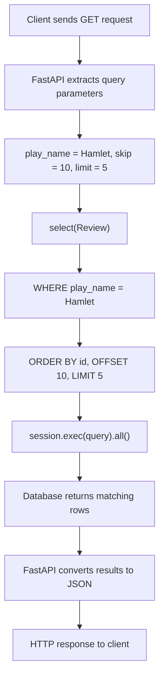

This route implements filtering and pagination. It lets a client retrieve reviews from the database, optionally filter by `play_name`, and control how many records are returned.

Let's understand it using actual HTTP requests and their equivalent SQL queries.

## 1. What comes from the outside?

Suppose your API runs at:

```
http://127.0.0.1:8000
```

The client can call these URLs:

| HTTP request                                    | Meaning                         |
| ----------------------------------------------- | ------------------------------- |
| `GET /reviews/`                                 | Get reviews                     |
| `GET /reviews/?play_name=Hamlet`                | Get reviews for Hamlet          |
| `GET /reviews/?skip=10`                         | Skip first 10 reviews           |
| `GET /reviews/?limit=5`                         | Return maximum 5 reviews        |
| `GET /reviews/?play_name=Hamlet&skip=0&limit=5` | Filter Hamlet reviews, return 5 |

These values are called query parameters. They come after `?` in the URL.

For example:

```
GET /reviews/?play_name=Hamlet&skip=0&limit=5
```

FastAPI automatically extracts these values and passes them into your function.

## 2. How FastAPI handles the parameters

Consider this part:

```
play_name: str | None = Query(    None,    description="Filter by play name")
```

- `str | None`: The parameter can be a string or `None`.
- `Query(None)`: It is optional; if the client doesn't send it, the value is `None`.
- `play_name=Hamlet`: FastAPI passes `"Hamlet"` to the function.

Similarly:

```
skip: int = Query(0, ge=0)limit: int = Query(10, ge=1, le=50)
```

| Parameter | Default | Validation               |
| --------- | ------- | ------------------------ |
| `skip`    | 0       | Must be 0 or greater     |
| `limit`   | 10      | Must be between 1 and 50 |

For example, `limit=100` results in a validation error (HTTP 422).

## 3. What SQL does SQLModel generate?

Your first line:

```
query = select(Review)
```

Equivalent SQL:

```
SELECT *
FROM review;
```

It starts by selecting all columns from the `review` table.

### Scenario A: Client sends no query parameters

Request:

```
GET /reviews/
```

Function receives:

```
play_name = Noneskip = 0limit = 10
```

Because `play_name` is `None`, this condition is skipped:

```
if play_name:    query = query.where(Review.play_name == play_name)
```

Then:

```
query = query.offset(skip).limit(limit)
```

Equivalent SQL:

```
SELECT *
FROM review
LIMIT 10 OFFSET 0;
```

Meaning: Return the first 10 reviews.

### Scenario B: Client filters by play name

Request:

```
GET /reviews/?play_name=Hamlet
```

Function receives:

```
play_name = "Hamlet"skip = 0limit = 10
```

This condition executes:

```
if play_name:    query = query.where(Review.play_name == play_name)
```

Equivalent SQL:

```
SELECT *
FROM review
WHERE play_name = 'Hamlet'
LIMIT 10 OFFSET 0;
```

Meaning: Find reviews where `play_name` is Hamlet and return up to 10 records.

### Scenario C: Client uses filtering and pagination

Request:

```
GET /reviews/?play_name=Hamlet&skip=10&limit=5
```

Function receives:

```
play_name = "Hamlet"skip = 10limit = 5
```

Equivalent SQL:

```
SELECT *
FROM review
WHERE play_name = 'Hamlet'
LIMIT 5 OFFSET 10;
```

Meaning:

1. Find all reviews for Hamlet.
2. Skip the first 10 matching reviews.
3. Return the next 5 reviews.

## 4. Visual example: How pagination works

Suppose the database contains these Hamlet reviews:

Matching database records

| Review ID | Play name |
| --------- | --------- |
| 1         | Hamlet    |
| 3         | Hamlet    |
| 5         | Hamlet    |
| 7         | Hamlet    |
| 9         | Hamlet    |
| 11        | Hamlet    |
| 13        | Hamlet    |
| 15        | Hamlet    |
| 17        | Hamlet    |
| 19        | Hamlet    |
| 21        | Hamlet    |
| 23        | Hamlet    |
| 25        | Hamlet    |
| 27        | Hamlet    |
| 29        | Hamlet    |

Request: `?play_name=Hamlet&skip=10&limit=5`

Returned records

| Review ID | Play name |
| --------- | --------- |
| 21        | Hamlet    |
| 23        | Hamlet    |
| 25        | Hamlet    |
| 27        | Hamlet    |
| 29        | Hamlet    |

The database first filters the matching records, then applies offset and limit.

## 5. What happens when this line executes?

```
reviews = session.exec(query).all()
```

Think of it as executing the SQL against your database.

Equivalent SQL for Scenario C:

```
SELECT *
FROM review
WHERE play_name = 'Hamlet'
LIMIT 5 OFFSET 10;
```

- `session.exec(query)` executes the generated SQL.
- `.all()` fetches all rows returned by that query.
- `reviews` contains the resulting list of Review objects.

Finally:

```
return reviews
```

FastAPI converts the returned objects into JSON, using:

```
response_model=list[ReviewRead]
```

Example response:

```
[
  {
    "id": 21,
    "play_name": "Hamlet",
    "reviewer_name": "John",
    "rating": 5,
    "comment": "Excellent performance"
  }
]
```

## 6. Complete flow



## 7. Two important points

1\. SQLModel doesn't immediately execute SQL.

These statements:

```
query = select(Review)query = query.where(Review.play_name == play_name)query = query.offset(skip).limit(limit)
```

Build a query object. SQL execution happens at:

```
session.exec(query)
```

2\. Add `order_by()` for predictable pagination.

Without an explicit order, the database doesn't guarantee which rows come first.

I would improve your query like this:

```
query = select(Review)if play_name:    query = query.where(Review.play_name == play_name)query = query.order_by(Review.id).offset(skip).limit(limit)reviews = session.exec(query).all()
```

Equivalent SQL:

```
SELECT *
FROM review
WHERE play_name = 'Hamlet'
ORDER BY id
LIMIT 5 OFFSET 10;
```

One small correction in your original code: `descrptoin` should be `description` in the `limit` parameter.

The key takeaway: Your Python code is building the equivalent of a SQL `SELECT`, optionally adding `WHERE`, then applying `ORDER BY`, `LIMIT`, and `OFFSET`. SQLModel translates that query into SQL for the database.