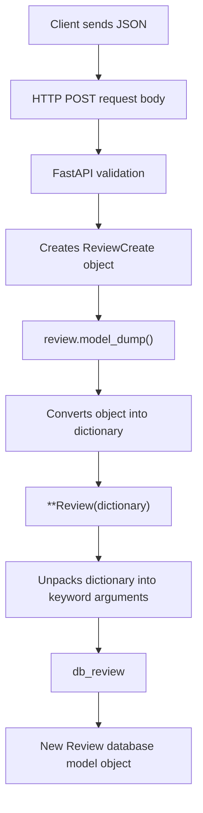

# SQLModel Review Schemas (models.py)

The four models serve different purposes in the API and database.

## 1. `Review` --- Database model

Defines the database table (`table=True`).

-   `id`: generated by the database.
-   `created_at`: set automatically.
-   Stores the review fields.

``` python
class Review(SQLModel, table=True):
    id: Optional[int] = Field(default=None, primary_key=True)
    play_name: str = Field(index=True)
    reviewer_name: str
    rating: int = Field(ge=1, le=5)
    comment: str
    created_at: datetime = Field(default_factory=datetime.now)
```

## 2. `ReviewCreate` --- API input model

Defines the data a client must send to create a review. The client does
not supply `id` or `created_at`.

``` python
class ReviewCreate(SQLModel):
    play_name: str
    reviewer_name: str
    rating: int = Field(ge=1, le=5)
    comment: str
```

## 3. `ReviewRead` --- API output model

Defines the fields returned to the client, including the generated `id`
and `created_at`.

``` python
class ReviewRead(SQLModel):
    id: int
    play_name: str
    reviewer_name: str
    rating: int = Field(ge=1, le=5)
    comment: str
    created_at: datetime
```

## 4. `ReviewUpdate` --- API update model

Allows partial updates. Fields are optional, so a client can update only
the rating or comment.

``` python
class ReviewUpdate(SQLModel):
    rating: Optional[int] = Field(default=None, ge=1, le=5)
    comment: Optional[str] = None
```

## 5. How all four models work together

### Create a review

``` text
Client
  |
  | POST /reviews (JSON review data)
  v
ReviewCreate
  |  Validates the incoming data
  v
Review
  |  Creates and saves the database record
  |  Database assigns id; created_at gets a default value
  v
ReviewRead
  |  Shapes/validates the API response
  v
Client receives the created review
```

### Update a review

``` text
Client
  |
  | PATCH /reviews/1 (only fields to change)
  v
ReviewUpdate
  |  Validates the supplied fields
  v
Existing Review record
  |  Applies only fields provided by the client
  |  Saves the changes
  v
ReviewRead
  |
  v
Client receives the updated review
```

## Quick summary

  Model            Purpose
  ---------------- --------------------------------------------
  `Review`         Defines what is stored in the database
  `ReviewCreate`   Validates data sent when creating a review
  `ReviewRead`     Controls the data returned by the API
  `ReviewUpdate`   Validates fields allowed during an update

**Key idea:** Keep the database model separate from API input and output
models. This controls what clients can send, what the database stores,
and what the API returns.

# Databse.py
```sql
SQLModel.metadata.create_all(engine)
```
tells SQLAlchemy/SQLModel: "Look at all the database table definitions in my Python code and create those tables in the database if they don't already exist."

1. What is metadata?
Think of metadata as a central collection of database table definitions.
Whenever you define a SQLModel class with table=True, SQLModel registers its table structure in SQLModel.metadata.

SQLModel class → Defines what a database table should look like.
SQLModel.metadata → Collects those table definitions.
create_all(engine) → Creates those tables in the connected database if missing.

# reviews.py
dependency injection examples
https://fastapi.tiangolo.com/tutorial/dependencies/?#declare-the-dependency-in-the-dependant

Q1 why i have used ** review.model_dump() , from outside i will already get the ReviewCreate  type inputs right as defined, is this because to convert from json to dict or something else, and why we need ** double start
Ans: model_dump() converts your Pydantic/SQLModel object into a Python dictionary.
** unpacks that dictionary into keyword arguments for the Review constructor.

Your endpoint:
```python
def create_review(review: ReviewCreate, session: SessionDep):
```

Suppose the client sends this JSON:
```json
{
    "play_name": "Hamlet",
    "reviewer_name": "John",
    "rating": 5,
    "comment": "Excellent performance"
}
```

FastAPI automatically:

- Receives the JSON request body.
- Validates it against `ReviewCreate`.
- Converts it into a `ReviewCreate` Python object.
- Injects that object into your `review` parameter.

So yes, you already receive a `ReviewCreate` object, not a raw JSON dictionary.
